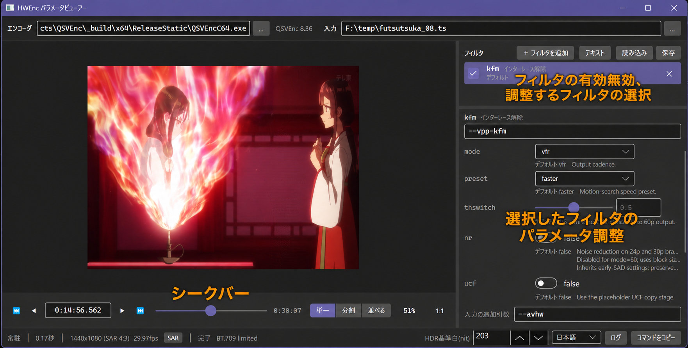

# HWEncParamViewer

[QSVEnc](https://github.com/rigaya/QSVEnc)/[NVEnc](https://github.com/rigaya/NVEnc)/[VCEEnc](https://github.com/rigaya/VCEEnc)のVPPフィルタの効果のプレビューを行います。

## 想定動作環境
- Windows 10/11 (x64)  
- Linux

## ダウンロードと実行

[Releaseページ](https://github.com/rigaya/HWEncParamViewer/releases)から、OSに合うファイルをダウンロードしてください。自己完結版なので.NETを別にインストールする必要はありません。対応するエンコーダは別に用意してください。

- Windows: `HWEncParamViewer_<版>_win-x64.zip`を展開し、`HWEncParamViewer.exe`を起動します。
- Linux: `HWEncParamViewer_<版>_linux-x64.tar.xz`を展開し、展開した場所で`./HWEncParamViewer`を実行します。実行権限は圧縮ファイルに含まれています。

配布物は実行ファイル1個です。ライセンスの文書はリポジトリの[LICENSE](LICENSE)と[THIRD_PARTY_NOTICES.txt](THIRD_PARTY_NOTICES.txt)を参照してください。

### Linuxの必要パッケージ

X11のデスクトップ環境で動作します。WaylandではXWaylandが必要です。一般的なデスクトップ環境なら追加の導入は不要です。

最小構成では、ICU、fontconfigとフォント、X11の共有ライブラリ(libX11、libICE、libSM、libXext、libXrandr、libXi、libXcursor、libXrender、libXfixes、libxcb)が必要です。日本語の表示には日本語フォントも必要です。

### 初回起動時のnativeライブラリ展開

実行ファイルに含まれるnativeライブラリは、初回起動時にWindowsでは`%TEMP%\.net`、Linuxでは`~/.net`へ展開されます。2回目以降は展開済みのファイルを使います。古い版の展開先は、画面を表示した後に自動で削除します。

展開先は`DOTNET_BUNDLE_EXTRACT_BASE_DIR`で変更できます。書き込み可能な場所を指定し、Linuxでは共有ライブラリを読み込めない`noexec`の場所を避けてください。

```bash
DOTNET_BUNDLE_EXTRACT_BASE_DIR="$HOME/.cache/HWEncParamViewer/native" ./HWEncParamViewer
```

## 使い方

アプリを開いたら、確認したい入力ファイルをドラッグドロップで開きます。

エンコーダが未指定なら、本体と同じフォルダを探します。候補の順はWindowsでQSVEncC64.exe、NVEncC64.exe、VCEEncC64.exe、Linuxでqsvencc、nvencc、vceencc、rkmppencです。同じフォルダに見つからない場合、LinuxだけはPATHの絶対パス要素を同じ候補順で探します。空要素と相対フォルダは探しません。Linuxでは実行権限のあるファイルだけを選びます。Windowsの32bit版は候補にしません。

自動で選んだ経路には「自動選択」と表示し、設定へは保存せず次回の起動で探し直します。利用者が指定した経路がある場合はそれを優先し、ファイルがなくても別のエンコーダへ切り替えません。見つかった候補がGPUに対応しない場合は、利用者がエンコーダを選び直してください。起動時の探索ではGPUの検査は行いません。


右側で有効にしたいフィルタを追加して、パラメータ調整して効き具合を確認してください。




## 対応エンコーダ

- [QSVEnc](https://github.com/rigaya/QSVEnc)
- [NVEnc](https://github.com/rigaya/NVEnc)
- [VCEEnc](https://github.com/rigaya/VCEEnc)

## ビルド方法

### Windows

MSVC2026をインストールし、`HWEncParamViewer.sln`を開いてビルドしてください。

### Linux

[.NET 10 SDKをインストール](https://dotnet.microsoft.com/ja-jp/download/dotnet/10.0)し、リポジトリのルートで次のコマンドを実行してください。初回ビルド時にNuGetパッケージが復元されます。

```bash
dotnet build src/HWEncParamViewer.App/HWEncParamViewer.App.csproj -c Release
dotnet run --project src/HWEncParamViewer.App/HWEncParamViewer.App.csproj -c Release --no-build
```


### 配布用の発行

通常の`dotnet build`と`dotnet test`は従来の構成です。単一ファイルの自己完結版を作る場合だけ、配布プロファイルと対象のRIDを指定します。

```bash
dotnet publish src/HWEncParamViewer.App/HWEncParamViewer.App.csproj -c Release \
  -p:PublishProfile=Distribution -r linux-x64 -o artifacts/publish/linux-x64
```

Windows向けはWindows上でRIDを`win-x64`にして発行します。配布プロファイルではPDBを出力に含めず、reflectionを使う設定の読み書きを保つためtrimは無効にしています。

## 版とライセンス

版はウィンドウのタイトルと`--version`で確認できます。開発時の定義は`Directory.Build.props`にあり、`scripts/get-version.sh`でも同じ文字列を取得できます。

ソースコードは[MITライセンス](LICENSE)です。依存ライブラリの著作権とライセンス本文は、リポジトリの[THIRD_PARTY_NOTICES.txt](THIRD_PARTY_NOTICES.txt)に記載しています。