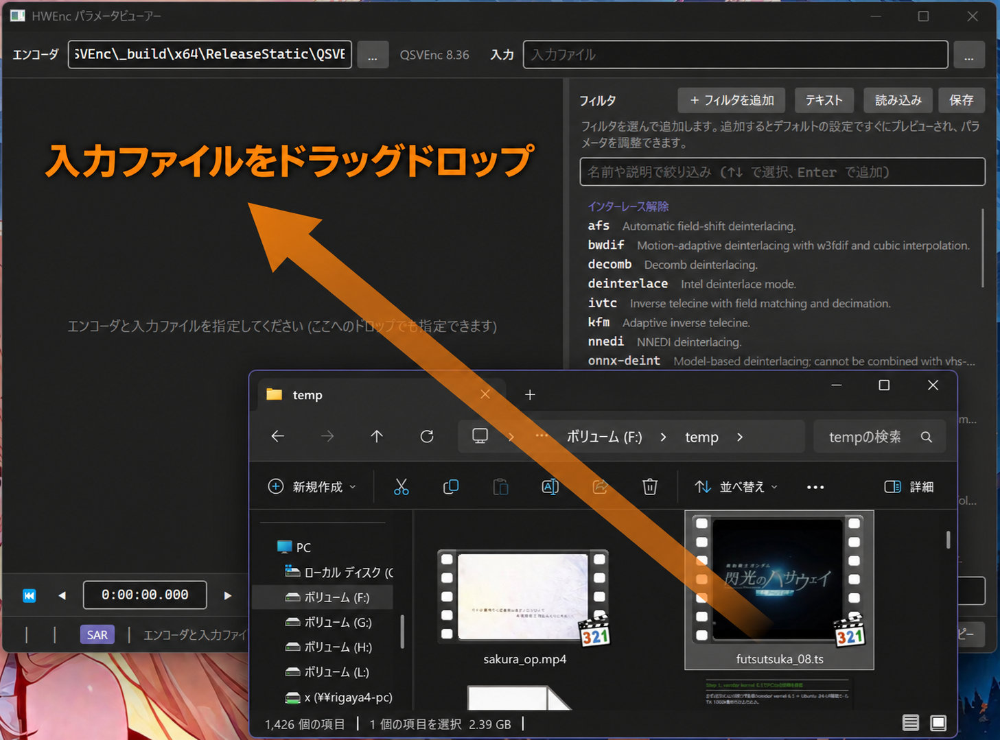

# HWEncVppPreview

[QSVEnc](https://github.com/rigaya/QSVEnc)/[NVEnc](https://github.com/rigaya/NVEnc)/[VCEEnc](https://github.com/rigaya/VCEEnc)のVPPフィルタの効果のプレビューを行います。

## 想定動作環境
- Windows 10/11 (x64)  
- Linux

## 準備

[こちら](https://github.com/rigaya/HWEncVppPreview/releases)から、ダウンロードして展開してください。

## 使い方

アプリを開いたら、確認したい入力ファイルをドラッグドロップで開きます。



右側で有効にしたいフィルタを追加して、パラメータ調整して効き具合を確認してください。


調整が終わったら、右下の「コマンドをコピー」をクリックすると、現在のコマンドをクリップボードにコピーできます。

## 対応エンコーダ

- [QSVEnc](https://github.com/rigaya/QSVEnc)
- [NVEnc](https://github.com/rigaya/NVEnc)
- [VCEEnc](https://github.com/rigaya/VCEEnc)

## Linuxでの実行について

最小構成では、ICU、fontconfigとフォント、X11の共有ライブラリ(libX11、libICE、libSM、libXext、libXrandr、libXi、libXcursor、libXrender、libXfixes、libxcb)が必要です。日本語の表示には日本語フォントも必要です。

### 初回起動時のnativeライブラリ展開

実行ファイルに含まれるnativeライブラリは、初回起動時にWindowsでは`%TEMP%\.net`、Linuxでは`~/.net`へ展開されます。

展開先は`DOTNET_BUNDLE_EXTRACT_BASE_DIR`で変更できます。書き込み可能な場所を指定し、Linuxでは共有ライブラリを読み込めない`noexec`の場所を避けてください。

```bash
DOTNET_BUNDLE_EXTRACT_BASE_DIR="$HOME/.cache/HWEncVppPreview/native" ./HWEncVppPreview
```

## ビルド方法

### Windows

MSVC2026をインストールし、`HWEncVppPreview.sln`を開いてビルドしてください。

### Linux

[.NET 10 SDKをインストール](https://dotnet.microsoft.com/ja-jp/download/dotnet/10.0)し、リポジトリのルートで次のコマンドを実行してください。初回ビルド時にNuGetパッケージが復元されます。

```bash
dotnet build src/HWEncVppPreview.App/HWEncVppPreview.App.csproj -c Release
dotnet run --project src/HWEncVppPreview.App/HWEncVppPreview.App.csproj -c Release --no-build
```


### 配布用の発行

通常の`dotnet build`と`dotnet test`は従来の構成です。単一ファイルの自己完結版を作る場合だけ、配布プロファイルと対象のRIDを指定します。

```bash
dotnet publish src/HWEncVppPreview.App/HWEncVppPreview.App.csproj -c Release \
  -p:PublishProfile=Distribution -r linux-x64 -o artifacts/publish/linux-x64
```

Windows向けはWindows上でRIDを`win-x64`にして発行します。配布プロファイルではPDBを出力に含めず、reflectionを使う設定の読み書きを保つためtrimは無効にしています。

## ライセンス

ソースコードは[MITライセンス](LICENSE)です。依存ライブラリの著作権とライセンス本文は、リポジトリの[THIRD_PARTY_NOTICES.txt](THIRD_PARTY_NOTICES.txt)に記載しています。